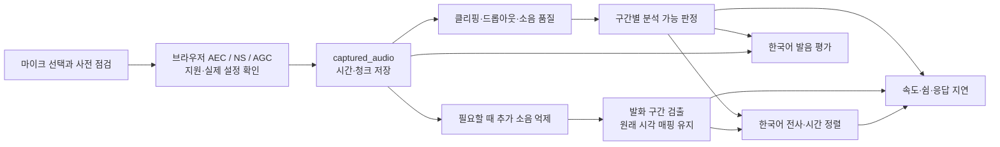
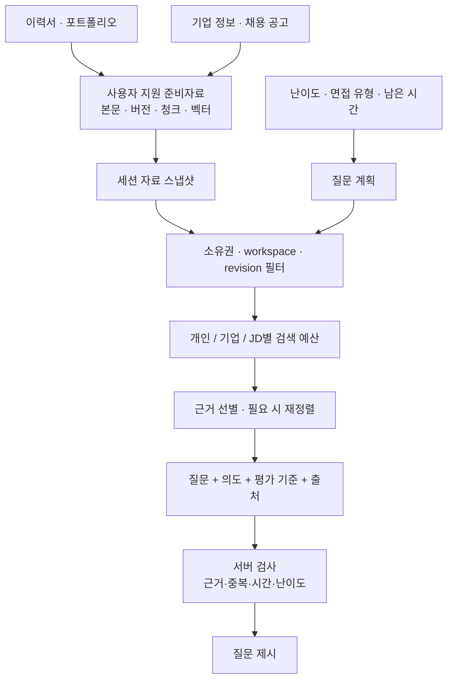
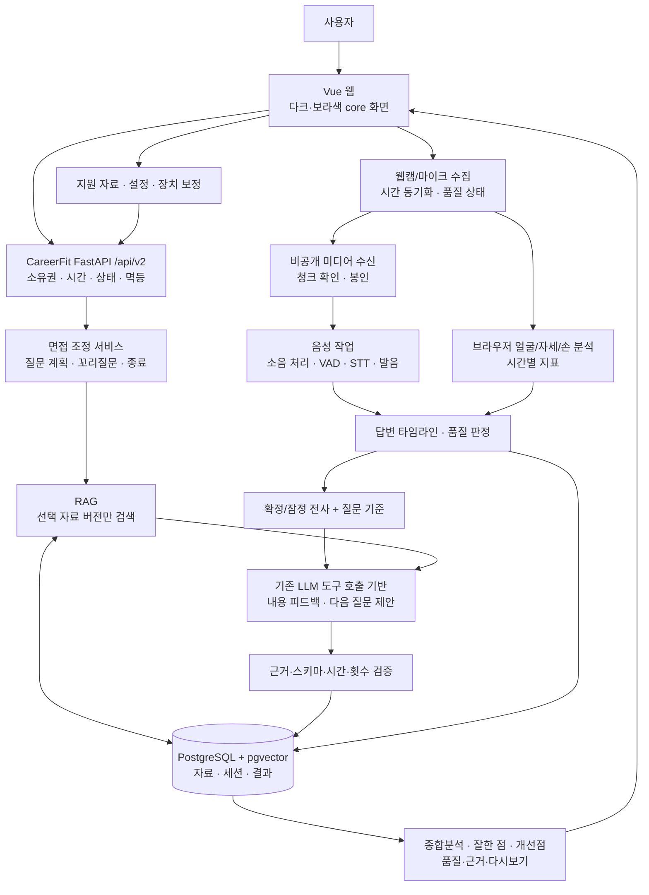
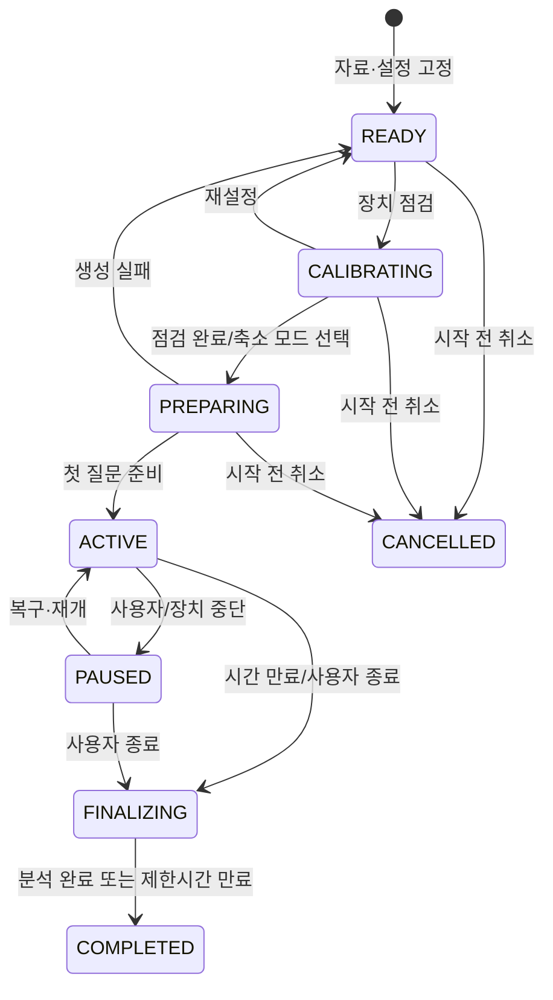
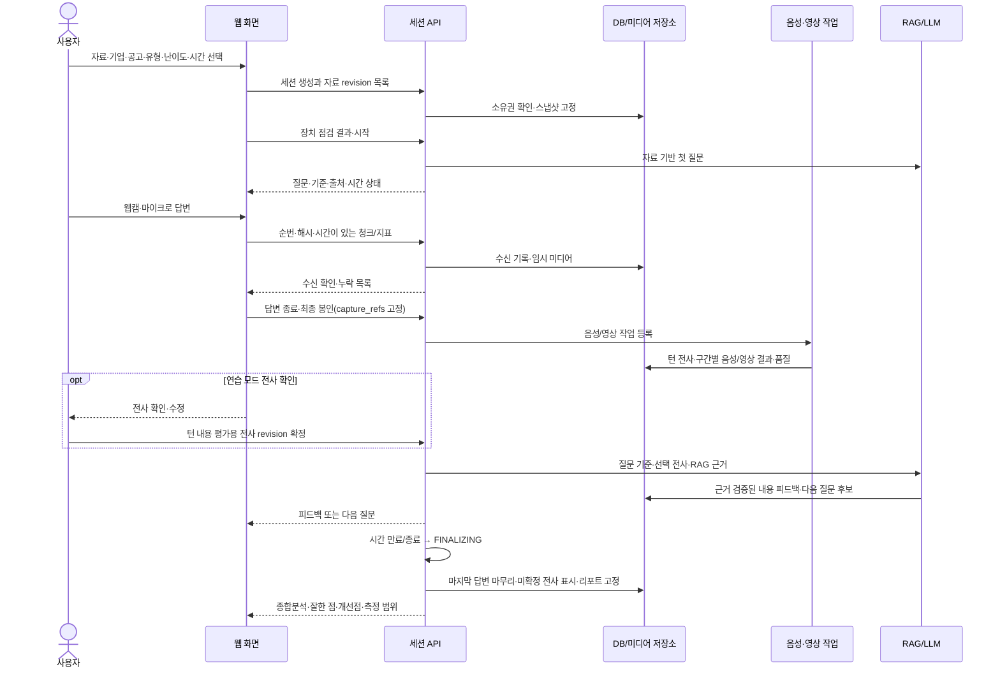
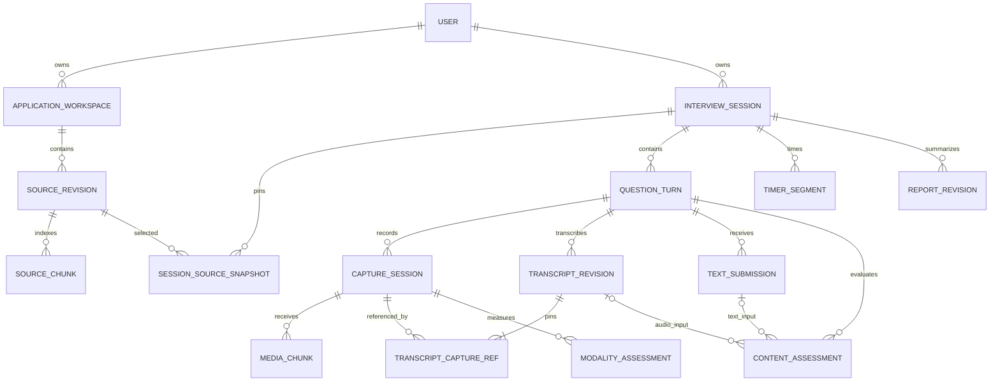

# 멀티모달 AI 면접 프로그램 — 통합 요구사항 명세서 및 설계도

버전: **v0.3** · 작성일: 2026-10-23 · 상태: 구현 전 설계 · 이전 문서: v0.2

이 문서는 사용자의 추가 요구사항을 반영한 현재 기준이다. v0.2의 ‘텍스트 우선·음성 후속·삼성전자 고정·질문 3개 고정 중심’ 범위를 대체한다. 실제 앱 코드·모델·DB는 변경하지 않았다. 아래 처리 방식·API·지표·기본값은 구현 설계이며 성능 검증 완료를 뜻하지 않는다.

## 1. 제품 정의와 변경 요약

**이력서·포트폴리오·지원 기업·채용 공고를 근거로 질문하고, 웹캠과 마이크로 답변 내용·전달력·시선 처리·제스처를 분석해 잘한 점과 개선 방법을 알려주는 개인용 면접 연습 프로그램**을 만든다.

화면은 `C:\work\core_pjt`의 다크·보라색 대시보드 느낌을 유지한다. 기능·데이터 기반은 `C:\work\interview_pjt`의 CareerFit AI(Vue/FastAPI/PostgreSQL/pgvector)를 확장한다.

| 영역 | v0.2 | v0.3 결정안 |
|---|---|---|
| 주 입력 | 텍스트 | 웹캠 + 마이크, 음성 전사 확인. 장애 시 축소 모드 |
| 영상 | 선택적 환경 확인 | 시선 방향 추정·자세·손 제스처의 시간별 관찰 |
| 음성 | 후속 기능 | 소음 처리·STT·발음·말하기 속도·응답 지연·쉼 분석 |
| 질문 근거 | 개인 자료 + 삼성전자 고정 corpus | 사용자별 이력서·포트폴리오·선택 기업 정보·채용 공고의 버전 고정 RAG |
| 설정 | 제한된 유형·질문 수 | 난이도·면접 유형·총 면접 시간·피드백 모드 |
| 진행 | 기본 3질문 제안 | 설정한 시간 우선, 질문 수·꼬리질문을 남은 시간에 맞춰 조절 |
| 결과 | 답변 중심 피드백 | 내용·음성·영상 종합분석 + 잘한 점 + 개선점 + 다시 연습할 구간 |
| 종료 | 늦은 결과 차단 중심 | 수집 종료 후 마지막 답변 분석을 마무리하는 FINALIZING 단계 |

### 사용자의 요구를 구체화한 원칙

- ‘시선’은 보정된 카메라 방향 유지 추정과 방향 변화로 표현한다. 집중력·성격을 추정하지 않는다.
- ‘답변 속도’는 말하기 속도, 첫 발화까지의 지연, 답변 길이, 쉼으로 나눈다.
- ‘발음’은 전용 음향 분석으로 평가한다. STT가 잘 알아들었다는 이유만으로 발음 점수를 만들지 않는다.
- 소음·가림·카메라 미검출은 **입력 품질 문제**로 처리한다. 미측정 항목을 0점으로 바꾸지 않는다.
- 이력서·공고·기업 자료는 사실 근거이고, 지원자가 말하지 않은 경험·수치로 모범 답변을 만들어 주지 않는다.
- 종합분석은 항목별 근거를 묶은 코칭이다. 채용 합격/불합격, 사람 간 순위, 감정·정직성 판정은 포함하지 않는다.

## 2. 사용자 흐름과 설정

### 전체 흐름

`지원 준비자료 등록 → 기업·공고·자료 버전 선택 → 난이도·유형·시간 설정 → 카메라·마이크 점검/보정 → 면접 → 분석 마무리 → 종합 리포트 → 구간 재연습`

### 설정 계약

| 항목 | 제공 옵션 | 동작 |
|---|---|---|
| 지원 대상 | 사용자 준비자료에서 기업과 채용 공고 선택 | 공고와 기업 일치 확인, 해당 자료만 RAG에 사용 |
| 직무 | 기존 6직무 + 공고의 실제 직무명 | 기존 코드와 공고 직무명을 함께 저장. 확장 직무 코드는 별도 검증 |
| 난이도 | 초급 / 중급 / 고급 | 개념·경험 설명 → 선택 근거·트레이드오프 → 복합 제약·반례·대안 검증 |
| 면접 유형 | 종합 / 직무·기술 / 경험·협업 / 이력서·포트폴리오 | 질문 주제와 평가 기준을 함께 변경 |
| 면접 시간 | 10 / 20 / 30분, 사용자 지정 5~60분 | 기본 제안 20분. 서버가 유효 진행 시간을 관리 |
| 피드백 모드 | 연습 / 실전 | 연습은 답변별 피드백·전사 확인, 실전은 종료 후 내용 피드백 |
| 장치 | 카메라·마이크 선택, 헤드폰 권장 안내 | 실제 권한·연결·수음·화면 품질 점검 |
| 분석 항목 | 내용 / 발음·유창성 / 시선 / 제스처 | 기본 모두 사용. 사용자가 끈 항목은 미평가로 표시 |
| 녹화 보관 | 리포트만 / 다시보기 포함 | 기본은 리포트만. 영상·음성 장기 보관은 별도 선택 |

난이도는 말투의 공격성이 아니라 질문의 깊이와 기준의 복잡도를 조절한다. 현재 프론트의 미지원 유형을 그대로 보내지 않고 서버 DTO·프롬프트·평가 기준·UI를 함께 수정한다.

### 면접 시간의 정확한 의미

선택한 시간은 **질문 재생·읽기, 생각, 답변에 사용한 유효 면접 시간**이다. TEXT 축소 모드의 생각·답변 작성 시간도 포함한다. 장치 보정, 서버 질문 생성·분석, 업로드 대기, 명시적 일시정지, 연습 모드의 피드백 읽기·전사 수정 시간은 제외한다. 화면에는 ‘면접 시간’과 ‘전체 경과’를 구분한다. 실전 모드에서는 피드백 읽기·전사 수정 단계가 면접 도중 나오지 않는다.

서버는 타이머 구간의 시작·종료를 원장으로 보존하며 브라우저 새로고침·탭 이동으로 시간이 늘어나지 않는다. 경고는 잔여 60초/15초를 제안한다. 제한 시간에 도달하면 새 질문을 막고 현재 녹음을 종료·봉인하며 `time_limit` 사유를 기록한다. 시간 때문에 잘린 답변은 ‘시간 종료로 중단’으로 표시하고 완결성 부족과 구분한다.

질문 수를 3개로 고정하지 않는다. 주제별 질문 계획을 만들고 남은 시간·예상 답변 길이·이미 다룬 역량을 보고 다음 질문을 선택한다. 기본 질문별 꼬리질문 상한 1회는 유지하되, 남은 시간이 부족하면 생략한다. 질문 설명 요청은 평가 답변 수에 포함하지 않는다.

## 3. 기능 요구사항

P0는 사용자가 요청한 핵심 제품 범위다. 개발을 나눠 진행해도 음성·영상 분석을 단순 후속 옵션으로 제외한 상태를 완성으로 보지 않는다. P1은 편의 확장이다.

| ID | 우선 | 요구사항 | 수락 기준 |
|---|---|---|---|
| REQ-01 | P0 | 지원 준비자료 관리 | 이력서·포트폴리오·기업 정보·채용 공고를 사용자별 저장, 수정은 새 버전, 삭제·처리 상태 조회 |
| REQ-02 | P0 | 기업·공고 선택 | 삼성 고정 해제, 선택 기업과 공고 관계 검증, 다른 기업/사용자 자료 혼입 차단 |
| REQ-03 | P0 | 자료 기반 질문 | 선택 자료 버전에서 검색한 근거로 질문 생성, 출처/위치와 질문 의도 보존 |
| REQ-04 | P0 | 난이도·유형·시간 | 선택값이 서버 질문 계획·평가 기준·TimerSegment 원장에 반영, 미지원 값·중복/역순 타이머 전이 거부 |
| REQ-05 | P0 | 장치 사전 점검 | 권한·연결·음량·클리핑·소음·얼굴/상체/손 가시성 확인, 시선/자세 기준 보정 |
| REQ-06 | P0 | 웹캠·마이크 수집 | 질문별 수집, 시간 동기화, 정지 시 구간 봉인·재개 시 새 capture_id, 이전 정상 구간 보존과 장치 중단 표시 |
| REQ-07 | P0 | 주변 소음 처리 | 적용 가능한 AEC/NS/AGC 확인, 필요 시 추가 억제, 품질 불량 구간 제외·재수음 안내 |
| REQ-08 | P0 | 음성 전사 | 한국어 STT와 시간 구간, 미인식 표시, 원전사·사용자 수정본 구분 |
| REQ-09 | P0 | 발음 피드백 | 한국어 음향 평가로 검증된 항목만 출력, 불확실 구간과 기술 용어 오인을 구분 |
| REQ-10 | P0 | 속도·유창성 | 응답 지연·답변 길이·침묵 포함/제외 말하기 속도·쉼·반복 표현과 근거 구간 표시 |
| REQ-11 | P0 | 시선 처리 | 개인 보정, 카메라 방향 유지 추정·변화 구간, 유효 관찰 비율·미측정 이유 |
| REQ-12 | P0 | 자세·제스처 | 얼굴/상체/손 좌표 기반 관찰, 반복 움직임·가림·화면 이탈 구간과 설명 제공 |
| REQ-13 | P0 | 답변 적절성 | 질문 관련성·완결성·구체성·근거·직무 연관성·기술 정확성을 인용/RAG로 설명 |
| REQ-14 | P0 | 꼬리질문 | 실제 답변의 빠진 맥락을 묻고 서버가 시간·중복·횟수 검사 |
| REQ-15 | P0 | 저장·복구 | 수집 메타데이터/청크 또는 TEXT 제출 원문 선저장, 중복·역순·누락 복구, 모델 실패 시 원문 보존 |
| REQ-16 | P0 | 제한 시간 종료 | cutoff 이전 마지막 데이터 수신·분석 마무리, 새 발화 차단, 부분 결과 명시 |
| REQ-17 | P0 | 종합 리포트 | 내용·음성·영상별 결과, 잘한 점·개선점·연습 과제, 근거와 측정 가능 범위 |
| REQ-18 | P0 | 다시보기·재연습 | 보관 선택 시 해당 구간 재생, 미보관 시 전사·시각·지표 표시, 재연습은 새 기록 |
| REQ-19 | P0 | 분석 불가 처리 | 소음·가림·장치 미사용·모델 실패를 미측정으로 표시, 감점으로 변환하지 않음 |
| REQ-20 | P0 | 자료·기록 삭제 | 접근 차단·revocation_version 증가·관련 작업 무효화, 결과 확정 때 재검사하여 원문/파생 결과 재저장 방지 |
| REQ-21 | P0 | 축소 모드 | 카메라 없음은 음성 전용, 마이크 없음은 TEXT 제출 계약으로 명시적 전환. 작성 시간 포함, 시청각 unavailable, 전체 분석 완료로 표시하지 않음 |
| REQ-22 | P0 | 원본·전사·분석 버전 | 어떤 녹음·전사·자료·모델·기준으로 평가했는지 추적, 수정 후 새 평가 버전 |
| REQ-23 | P1 | 공개 URL 가져오기 | 사용자가 지정한 공개 기업/공고 URL을 가져와 본문 확인 후 새 자료 버전 저장 |
| REQ-24 | P1 | 추세·내보내기 | 같은 유형·기준·품질 조건에서 비교, 누락 항목 0점화 금지, 읽기용 보고서 내보내기 |

URL 자동 수집 없이도 파일 업로드·본문 붙여넣기로 모든 자료 종류를 등록할 수 있어야 한다. 스캔 PDF는 추출 실패를 명확히 표시하고 OCR 또는 텍스트 입력 경로를 제공한다.

## 4. 평가 항목과 측정 명세

### 공통 결과 형식

모든 항목에 `value/unit`, `status(valid/low_quality/unavailable)`, `valid_coverage`, `exclusion_reason`, `evidence_interval`, `model_version`, `pipeline_version`, `threshold_version`을 보존한다. 측정 가능 비율은 전체 답변 구간 중 그 지표를 계산할 수 있었던 비율이다.

질적 피드백은 ‘잘한 점 / 개선할 점 / 관찰 / 판단 보류’를 사용한다. 통계 수치는 측정값으로 표시하고, 평가 기준을 검증하기 전 임의의 총점·가중 평균을 제품의 기본 결과로 제시하지 않는다. 종합분석과 단일 총점은 같은 기능이 아니다.

### 4.1 시선 처리

| 지표 | 산출 방법 | 해석 제한 |
|---|---|---|
| 카메라 방향 유지 추정 | 정면 기준 보정 후 얼굴 방향·홍채의 상대 위치 등으로 분류한 시간 / 유효 관찰 시간 | 정밀 응시점·눈맞춤 정확도를 보장하지 않음 |
| 방향 변화 구간 | 보정 범위 밖 방향이 일정 시간 이어진 구간과 변화 빈도 | 화면의 질문을 읽는 구간은 별도 표시 |
| 유효 관찰 비율 | 얼굴/눈 특징이 충분히 보이는 시간 / 답변 시간 | 미검출·가림·안경 반사 구간은 이탈로 계산하지 않음 |

기준 보정은 카메라 위치·자세를 맞춘 뒤 렌즈 방향/화면 방향을 보는 짧은 안내로 수행한다. 실패하면 고개 방향 관찰만 제공하고 시선 분류는 미측정으로 둔다. 보정 후에도 ‘시선 추정’임을 표시한다.

MediaPipe Face Landmarker의 랜드마크·변환행렬은 재료이며 면접 지표는 별도 개발해야 한다. Iris만으로 실제로 어디를 보는지 알 수 있다고 설계하지 않는다. [Face Landmarker](https://developers.google.com/edge/mediapipe/solutions/vision/face_landmarker), [Iris의 한계](https://github.com/google-ai-edge/mediapipe/blob/master/docs/solutions/iris.md)

### 4.2 자세·제스처

- 어깨너비로 정규화한 상체 중심 이동, 몸통 기울기의 변화, 관찰 가능한 손의 이동·반복 구간을 기록한다.
- 손이 프레임 밖이면 ‘손 관찰 불가’다. 제스처를 전혀 하지 않았다는 뜻으로 처리하지 않는다.
- 움직임이 많다/적다만으로 감점하지 않는다. 특정 구간의 반복 동작, 얼굴 가림, 프레임 이탈을 근거로 화면 전달 방식을 코칭한다.
- 얼굴·상체·손 분석은 각각 가시성과 품질을 확인한다. 지원자 한 명이 아닌 장면은 다른 사람의 특징을 합치지 않고 분석을 보류한다.
- 기본 브라우저 분석 빈도는 장치 성능에 따라 조절하며 초기 목표 5~15fps를 제안한다. 미리보기 프레임률과 분석률은 구분한다. 시간 기반 집계로 프레임률 저하가 지표를 왜곡하지 않게 한다.

현행 core의 손 제스처만으로 얼굴·자세 분석이 되는 것은 아니다. [Pose Landmarker](https://developers.google.com/edge/mediapipe/solutions/vision/pose_landmarker), [Hand Landmarker](https://developers.google.com/edge/mediapipe/solutions/vision/hand_landmarker)를 후보로 두고 신규 모델·검증을 포함한다.

### 4.3 발음

- STT와 분리된 한국어 음향 평가 어댑터를 둔다. 한국어 즉흥 발화에서 지원·검증된 단어/음소 명료도 항목만 표시한다.
- 원어·외래어·기술 용어·약어·숫자 읽기와 방언을 일반 단어 오발음으로 단정하지 않는다. 등록한 직무 용어 사전과 사용자의 전사 확인을 참고한다.
- 원전사 오류를 발음 오류로 치환하지 않는다. 원음 근거가 부족하면 ‘다시 들어볼 구간’ 또는 ‘발음 판단 보류’다.
- 사용자 수정 텍스트는 내용 평가에 쓸 수 있지만 발음 평가의 기준 발화로 자동 대체하지 않는다. 자유 발화 평가와 별도의 문장 읽기 점검을 구분한다.
- 음향 품질이 나쁜 구간과 과도한 소음 억제로 발음이 손상된 구간은 제외한다. 음성 크기로 자신감·인성을 추정하지 않는다.

예를 들어 Azure의 한국어 발음 평가를 공급자 후보로 검토할 수 있다. 공식 문서의 ko-KR 지원과 별개로 한국어 기술 면접 데이터에 대한 검증이 필요하며, 해당 서비스의 prosody 평가는 en-US만 지원하므로 한국어 억양 점수를 제공한다고 가정하지 않는다. 공급자는 확정하지 않았고 외부 전송·비용·보관 정책을 확인해 선택한다. [지원 언어](https://learn.microsoft.com/en-us/azure/ai-services/speech-service/language-support?tabs=pronunciation-assessment), [발음 평가 기능](https://learn.microsoft.com/en-us/azure/ai-services/speech-service/how-to-pronunciation-assessment)

발음 기능은 핵심 범위다. 검증 가능한 엔진을 확보하지 못하면 발음 분석 미완료로 공개하며 STT 신뢰도로 대체해 완료 처리하지 않는다.

### 4.4 답변 속도·유창성

| 지표 | 정의 |
|---|---|
| 응답 시작 지연 | TTS 재생의 ended 이벤트 또는 텍스트 질문의 ‘질문 확인·답변 준비’ 버튼 시점부터 첫 유효 지원자 발화까지. 장치 오류·질문 재생음 제외, 기준 이벤트가 없으면 미측정 |
| 답변 길이 | 답변 시작~종료의 유효 시간. 기술적 중단 제외 |
| 말하기 속도 | 품질이 유효한 구간의 시간 정렬 음성 전사 어절 수 / 같은 구간의 침묵 포함 시간 × 60 |
| 발화 속도 | 같은 유효 구간의 어절 수 / 해당 구간에서 VAD가 검출한 발화 시간 × 60 |
| 쉼 | 침묵 비율, 긴 쉼의 위치·길이. 끊긴 녹음은 침묵이 아님 |
| 반복·군더더기 | ‘음’, ‘어’ 등 문맥상 반복 구간. 단어 내부 문자열 일치만으로 세지 않음 |

한국어 어절/분을 기본 단위로 하고 숫자·영문 표기 정규화 정책과 버전을 기록한다. 음절/분은 필요 시 보조 지표다. 사용자 수정본·LLM 개선 답변의 글자 수로 속도를 계산하지 않는다. 소음 구간의 전사를 분자에서 제외했다면 그 시간도 속도 분모에서 제외하고, 전체 답변 길이와 유효 관찰 비율은 별도로 표시한다. 보편적인 ‘정답 속도’를 강요하지 않고 사용자 기준과 구간 변화를 보여준다.

### 4.5 답변 적절성

평가 기준은 질문의 의도, 요구사항 충족, 구체적인 행동·근거, 답변 구조, 지원 직무/JD와의 관련성, 검증 가능한 기술적 정확성이다. 기술 정확성과 기업 사실은 참고자료가 있는 범위에서 판단한다.

각 피드백에 실제 답변 인용과 질문 기준을 연결한다. 이력서에 없던 경험을 말했다고 허위로 판단하지 않고 확인 질문을 만든다. 자료와 답변의 불일치는 두 근거를 보여주고 해소를 요청한다.

연습 모드는 턴 전체 전사를 확인한 후 내용을 평가한다. 실전 모드는 자동 전사 기반 결과를 잠정 표시하고 종료 후 수정하면 내용 평가를 새 버전으로 생성한다. 음성·영상 결과는 원래 수집 구간에 계속 연결한다. 불명확한 전사 구간을 근거로 답변 내용의 부족함을 단정하지 않는다.

COACHING에서 종료 시점까지 전사를 확정하지 않았으면 해당 내용 평가는 `awaiting_transcript_confirmation`으로 남긴다. 음성·영상 분석을 마무리한 부분 리포트를 만들며 사용자 확인 때문에 FINALIZING 제한시간을 무한 연장하지 않는다. 종료 후 확인·수정은 새 내용 평가와 명시적 새 리포트 revision으로 연결하고, 녹음·질문 진행·면접 타이머를 재개하지 않는다. TEXT 축소 모드는 명시적인 답변 제출 자체를 원문 확정으로 보며 별도 음성 전사 확인을 요구하지 않는다.

### 4.6 종합 리포트

1. 전체 요약: 질문의 요구를 어떻게 충족했고 어떤 전달 방식이 나타났는지.
2. 잘한 점: 실제 문장·발화 구간·관찰 지표에 연결된 2~3개 핵심 사례.
3. 개선할 점: 근거 구간, 왜 보완할지, 다음 답변에서 할 행동을 함께 제시.
4. 분야별 분석: 답변 내용 / 발음·속도·쉼 / 카메라 방향 / 자세·제스처.
5. 측정 범위: 입력 품질·유효 관찰 비율·미측정 사유. 소음은 별도 환경 항목.
6. 다음 연습: 한 가지 질문 다시 답하기, 특정 부분 말하기 연습, 기기 위치 조정 등.

모든 종합 주장에는 근거가 있어야 한다. 상충된 분석은 숨기지 않고 표시한다. 원본 미보관이면 재생 버튼 대신 전사·시각·지표를 제공한다. 예시 리포트의 수치는 시안임을 표시하며 실제 사용자 결과처럼 제시하지 않는다.

## 5. 소음·오디오 처리 설계



1. 장치 점검에서 짧은 무음과 읽기 샘플을 받아 수음·클리핑·배경음·처리 적용 여부를 확인한다.
2. `echoCancellation`, `noiseSuppression`, `autoGainControl`을 요청하되 지원/적용 여부는 실제 설정으로 확인한다. 요청했다는 사실만으로 ‘소음 제거 완료’라고 표시하지 않는다. 브라우저 처리 뒤 신호는 센서 원음이 아니라 `captured_audio`로 명명한다. [MediaTrackConstraints](https://developer.mozilla.org/en-US/docs/Web/API/MediaTrackConstraints), [MediaTrackSettings](https://developer.mozilla.org/en-US/docs/Web/API/MediaTrackSettings)
3. 브라우저 처리로 충분하면 추가 억제를 생략한다. 필요 시 RNNoise 등의 후보를 검증하고 과도한 이중 억제로 자음·어미가 손상되지 않는지 비교한다. 전용 발음 분석은 수집 신호와 추가 처리 신호의 조건을 기록한다. [RNNoise](https://github.com/xiph/rnnoise)
4. VAD는 발화/비발화 구간 분리에 사용한다. 다른 사람이 말한 음성을 지원자 음성과 구분하는 장치가 아니다. 검증된 겹침/화자 구간 감지 모듈의 신호 또는 사용자가 ‘주변 말소리가 섞였음’으로 표시한 구간을 보류하고 다시 답하기를 제공한다. 화자 구간 구분은 실제 인물의 신원 식별을 뜻하지 않는다. 해당 신호가 없을 때 모든 타인 발화를 자동 구별·제거한다고 보장하지 않는다. [Silero VAD](https://github.com/snakers4/silero-vad)
5. 첫 버전은 질문 TTS 재생과 답변 수음을 순차로 진행한다. 질문 오디오가 끝난 시각을 기록하고 TTS 누출 구간은 지원자 발화에 포함하지 않는다.
6. 팬 소음, 키보드/문 닫힘 같은 순간 소음, 질문 재생음, 주변 대화를 각각 시험한다. 억제 실패 시 기술적 품질 경고를 표시하며 면접 능력 감점으로 사용하지 않는다.

무조건 조용한 구간만 잘라 붙여 답변 속도를 계산하지 않는다. 음성 전처리에서 제거한 구간의 원래 시작/끝 시각을 보존해야 쉼과 응답 지연을 복원할 수 있다.

## 6. 자료 저장과 RAG 설계

### 6.1 지원 준비자료 묶음

기업·공고별 `ApplicationWorkspace`를 만든다. 한 사용자에게도 서로 다른 이력서, 회사, 공고가 있을 수 있으므로 세션이 명시적으로 선택한 자료만 사용한다.

| 자료 종류 | 저장·추출 내용 | 질문 활용 |
|---|---|---|
| RESUME | 경력·학력·역할·기술 등 사용자 자료, 본문 위치 | 경험 확인·역할·성과 근거 |
| PORTFOLIO | 프로젝트·문제·설계·기여·성과 | 설계 이유·실패·트레이드오프 |
| COMPANY_INFO | 회사 소개·제품·기술·가치 등 제공 자료 | 기업 관련 질문과 지원 동기 |
| JOB_DESCRIPTION | 공고 제목·업무·필수/우대 역량·마감 등 | 직무 관련 역량과 경험 연결 |

DB에 메타데이터·추출 본문·버전·청크·임베딩을 저장한다. 원본 파일과 선택 보관 영상은 비공개 파일/객체 저장소에 두고 DB에 참조·해시·보관 기한을 저장한다. 대용량 영상 전체를 DB의 Base64 문자열로 넣지 않는다.

신규 기업/JD 자료는 사용자 소유 준비자료로 저장한다. 기존 전역 Company 행과 공유 삼성 corpus를 사용자 입력으로 덮어쓰지 않는다. 공개 출처도 사용자별 선택 버전과 접근 범위를 가진다. 기업명만 같다는 이유로 모든 공고·자료를 합치지 않는다.

### 6.2 적재와 버전

`업로드/붙여넣기 → 형식·소유권 검사 → 텍스트 추출/OCR 필요 판정 → 항목 추출과 사용자 확인 → 청크 → 임베딩 → READY`

각 `SourceRevision`은 불변이며 자료 종류·소유자·기업/JD 관계·제목·출처·발행일(미상 가능)·수집일·확인일·콘텐츠 해시·처리 상태를 가진다. 수집일은 최신성 보증이 아니다. 공고 마감·날짜 미상·오래된 자료는 표시하되 과거 공고 연습은 허용한다.

자료 수정은 새 버전을 만든다. 면접 생성 시 `SessionSourceSnapshot`에 선택 revision을 고정한다. 새 인덱스로 바뀌어도 진행/완료 면접의 근거를 조용히 교체하지 않는다. 임베딩 모델·차원이 바뀌면 새 인덱스를 만들며 현재 4096차원 벡터와 혼용하지 않는다.

자료 삭제는 일반 수정과 구분한다. 삭제 트랜잭션에서 해당 revision의 `deleted_at`과 `revocation_version`을 갱신하고 이를 입력으로 가진 대기/실행 작업을 무효화한다. 작업은 입력 snapshot에 사용한 revision별 폐기 버전을 기록하며, 질문·내용 평가·리포트 결과를 확정하는 짧은 트랜잭션에서 소유권, `deleted_at`, `revocation_version`을 다시 검사한다. 삭제와 결과 저장이 원자적으로 순서화되도록 같은 revision의 잠금 또는 조건부 쓰기를 사용한다. 삭제된 근거는 메모리에 이미 검색되어 있어도 결과·기억·캐시에 다시 저장하지 않는다. snapshot의 버전 고정은 삭제 이후의 재사용 권한이 아니다.

### 6.3 검색과 질문 생성



검색 범위는 **인증 사용자 → 선택 workspace → 세션 snapshot의 revision → 자료 종류** 순으로 제한한다. 검색 후 LLM에게 다른 사용자 문서를 무시하라고 시키는 방식으로 대체하지 않는다.

벡터 검색을 기반으로 키워드 후보 검색과 재정렬을 추가 검토한다. 한국어·기술 약어·정확한 제품명 품질은 별도로 확인한다. 개인 자료가 검색 예산을 모두 써서 JD 근거가 빠지지 않도록 자료 종류별 예산을 둔다.

질문 객체에는 본문, 질문 의도, 확인하려는 역량, 난이도, 평가 기준 버전, 실제 근거 청크, 예상 답변 시간을 저장한다. 예를 들어 ‘이력서의 캐시 개선 경험’과 ‘JD의 성능 최적화 업무’를 연결해 선택 이유·검증 방법을 묻는다. 자료에 없는 경험을 이미 했다고 전제하지 않는다.

지원자 자료 또는 JD가 없으면 맞춤형 근거 부족을 표시하고 사용자가 일반 연습으로 진행할지 선택한다. 검색 결과가 없다고 삼성 자료로 자동 복귀하지 않는다. 기업 사실에 대한 답변은 검증된 공개 출처/업로드 자료가 있는 범위로 제한한다.

## 7. 전체 시스템 설계도



### 실행 책임

- Vue: 장치 선택·교정·수집·청크 재전송·잠정 전사·면접 화면. 얼굴/손/자세 추론은 Web Worker 등으로 UI를 막지 않는 구조를 우선 검토한다.
- FastAPI: 인증·자료 범위·세션 타이머·수집 봉인·작업 등록·최종 결과 확정.
- 작업 처리기: 오디오 처리, 전사·정렬, 발음, 필요 시 영상 후처리, RAG/LLM, 리포트. 작업 상태는 DB에 보존한다.
- PostgreSQL/pgvector: 원장·검색·버전·지표. 파일 저장소: 원본 문서와 임시/선택 보관 미디어.
- LLM: 질문·내용 피드백·종합 문장 생성. 카메라 영상만 보고 음성·발음·심리를 판단하지 않는다.
- core의 YOLO/VLM은 선택적 프레임 품질/환경 점검에 사용할 수 있다. 모든 영상 프레임을 VLM에 보내는 구조는 채택하지 않는다.

현재 PC가 CPU 중심이므로 음성·영상·LLM을 모두 동시에 최고 설정으로 실행한다고 가정하지 않는다. UI 수집을 우선 보장하고 분석 빈도·동시 작업 수를 측정해 조절한다. 실제 모델 및 로컬/외부 실행 위치는 한국어 품질·지연·자원·비용·데이터 전송 조건을 확인해 정한다.

## 8. 시간·상태·수집 계약

### 8.1 세션 상태



종료 사유는 `time_limit / user_finish / technical_failure`로 별도 저장한다. 결과 상태는 `complete / partial / failed`를 분리한다. 카메라를 사용하지 않은 음성 전용 결과는 모든 분야 분석 완료로 표시하지 않는다.

한 음성 턴은 `QUESTION_PLAYBACK → AWAITING_SPEECH → RECORDING → SEALED → ANALYZING → REVIEW_READY`다. 여기서 SEALED는 턴의 최종 봉인을 뜻한다. 일시정지에 따른 구간 봉인은 턴을 완료하지 않으며 재개 후 같은 턴의 수집을 이어간다. 연습 모드의 전사 확인은 최종 SEALED 이후 내용 평가 전 별도 `TRANSCRIPT_REVIEW` 단계다. 실전 모드는 자동 전사로 진행하고 불확실성을 표시한다. 무음만 수집되면 답변으로 점수화하지 않고 다시 답하기/건너뛰기를 제공한다.

TEXT 축소 모드는 `QUESTION_PLAYBACK → AWAITING_TEXT → TEXT_SUBMITTED → ANALYZING → REVIEW_READY`로 진행한다. 사용자가 제출한 텍스트를 먼저 저장하고 분석 작업을 등록하며, 해당 턴에는 가짜 음성 capture·ASR 전사를 만들지 않는다. 제출 전 공백·길이·문맥 예산을 검사하고 실패하면 작성창 원문을 유지한다. 수락한 명시적 제출은 원문 확정이며 이후 모델 오류에도 저장본을 보존한다. 작성 중 시간 만료로 제출되지 않은 초안은 분석하지 않고 미제출로 표시한다. 시청각 지표는 `unavailable`/`text_mode`이며 텍스트 길이로 발음·발화 속도를 대신 계산하지 않는다.

### 8.2 수집·동기화

- 수집 구간 단위는 `capture_id`, 답변 전체는 `turn_id`, 트랙은 `audio/video/features`로 구분한다. 한 턴에 여러 capture가 연결될 수 있다.
- 청크 키 `(capture_id, track, sequence_no)` + 콘텐츠 해시로 멱등 처리한다. 같은 번호·다른 해시는 충돌이다.
- 각 청크/지표의 `start_ms/end_ms`는 해당 capture 시작 기준이다. capture에는 정지 시간을 제외한 턴 기준 `turn_offset_ms`를 두어 `턴 시각 = turn_offset_ms + 구간 시각`으로 매핑한다. 서버 수신 시각과 미디어 시각을 혼동하지 않는다.
- 오디오 청크는 초기 제안 1~2초 단위다. 브라우저 컨테이너의 조각이 독립적으로 디코딩된다고 가정하지 않고 MIME·초기 헤더·순서·시간 정보를 보존해 조립한다.
- 서버가 승인한 연속 순번과 누락 목록을 반환한다. 재전송은 제한된 로컬 버퍼에서 수행하며 완료/취소 시 정리한다. 버퍼 상한 초과는 데이터 유실 상태로 표시하고 숨기지 않는다.
- `seal`은 트랙별 마지막 순번·종료시각·총길이·해시와 `is_final_for_turn`을 포함한다. 누락이 있으면 보완 또는 명시적 부분 봉인을 선택한다.
- pause 시 열린 capture를 `is_final_for_turn=false`로 구간 봉인한다. resume 시 같은 `turn_id`에 새 `capture_id`와 별도 generation을 발급하고 이전 봉인 구간 다음의 `turn_offset_ms`로 이어간다. 새 capture는 순번을 다시 시작할 수 있으며 이전 capture의 키·generation을 재사용하지 않는다. 이전 구간의 정상 전사 조각·음성·영상 결과는 유지한다.
- 답변 종료 또는 세션 cutoff의 최종 봉인은 `is_final_for_turn=true`로 턴의 순서 있는 `capture_refs`와 각 구간의 봉인 버전을 고정한다. 정지 상태에서 종료해 열린 capture가 없더라도 기존 봉인 구간 목록으로 턴을 확정한다. 최종 봉인 후 같은 턴에 새 capture를 추가하지 않는다.
- 구간별 ASR은 잠정 조각이며, 최종 봉인한 `capture_refs`를 턴 타임라인에 정렬해 `TranscriptRevision(turn_id, capture_refs)`을 생성한다. 내용 평가는 구간마다 따로 중복 생성하지 않고 확정된 턴 전사 revision을 사용한다. 끊김·부분 봉인 구간은 누락으로 표시하며 정지 시간을 쉼으로 합산하지 않는다.
- 음성·영상·전사 지표는 동일 답변 타임라인에 정렬한다. 초기 검증 목표는 근거 구간 동기화 오차 ±300ms 이내이며 실측 후 확정한다.
- `control_version`은 질문·정지/재개·종료 같은 제어 전이에만 사용한다. 청크·병렬 STT/영상 결과는 각 capture의 고정 generation, `analysis_revision`, 활성 작업 ID로 검증한다. resume로 새 capture가 생겼다는 이유만으로 이전 정상 구간의 작업을 무효화하지 않는다. 턴 전사/내용 작업은 고정된 `capture_refs`·봉인 버전·전사 revision을 함께 확인한다.

### 8.3 종료 시 마지막 답변 보존

1. 서버가 종료 cutoff를 확정하고 새 수집·새 질문을 막는다.
2. cutoff 이전 녹음된 마지막 청크는 제한된 업로드 유예시간 안에 수신한다. 제안 기본 15초이며 재접속 조건과 함께 검증한다.
3. 마지막 턴의 capture 목록을 최종 봉인하고 FINALIZING에서 STT·음성·영상·내용 작업을 마무리한다. TEXT 모드는 cutoff 전에 수락한 제출만 포함하며 미제출 초안을 자동 제출하지 않는다.
4. 분석 마무리 제한시간은 초기 제안 120초다. 초과하면 완료된 항목으로 부분 리포트를 만들고 재시도 가능 항목을 표시한다.
5. 최종 리포트가 고정된 뒤 늦은 결과가 조용히 덮어쓰지 못하게 한다. 명시적 재분석은 새 리포트 버전이다.

COACHING의 최종 턴 전사가 미확정이면 내용 평가는 `awaiting_transcript_confirmation`으로 남기고 다른 완료 항목으로 부분 리포트를 고정한다. 확인을 기다리는 시간을 120초 분석 마무리 제한에 추가하지 않는다. 완료 이후 전사 확인·수정과 내용 평가 작업은 허용하되 결과는 새 리포트 revision에만 반영한다. 이 절차는 세션을 ACTIVE로 되돌리거나 타이머·수집을 재개하지 않는다.

‘수집 종료’와 ‘결과 저장 금지’를 동일하게 취급하지 않는다. 반면 **삭제된 세션은 모든 후속 저장을 차단**한다. 사용자가 종료해도 이미 말한 마지막 답변은 위 절차로 보존한다.

### 8.4 서버 타이머 이벤트와 구간 원장

`TimerSegment`에 세션/턴, 단계, 시간 포함 여부, 서버가 확정한 시작·종료, 시작/종료 이벤트 ID를 저장한다. 같은 세션의 열린 시간 구간은 하나이며 구간은 겹치지 않는다. 서버는 구간 합계와 현재 열린 구간으로 `active_elapsed_ms`를 계산한다. 브라우저가 보낸 남은 시간이나 경과 합계로 이를 덮어쓰지 않는다.

| 이벤트/전이 | 타이머 처리 |
|---|---|
| `question_presented` | 서버가 준비한 현재 질문의 표시/재생 시작을 확인하고 질문 시간 구간 시작 |
| `question_playback_finished` / `reading_complete` | 실제 TTS ended 또는 질문 확인 버튼의 이벤트. 질문 구간을 닫고 생각·음성 대기 또는 TEXT 작성 구간으로 전환. 둘 다 시간에 포함 |
| 첫 발화·capture 수집 | 같은 답변의 유효 시간은 계속 포함. 첫 발화 시각은 지표 근거로 별도 보존 |
| 최종 seal / TEXT 제출 수락 | 답변/작성 구간을 닫고 업로드·분석·전사 확인은 제외 |
| pause / 장치 중단 | 서버가 중단을 확정해 포함 구간을 닫음. resume에서 새 구간과 필요한 새 capture 시작 |
| cutoff / finish | 열린 포함 구간을 한 번만 닫고 이후 FINALIZING·종료 후 확인/재평가는 제외 |

클라이언트 이벤트는 `event_id`, `turn_id`, 질문 표시 식별자, 이벤트 종류, 수집 시계의 시각과 `expected_control_version`을 보낸다. 서버가 현재 단계·질문·이벤트 순서와 시계 매핑을 검사해 원장 시각을 확정한다. 수신 시각을 미디어 시각으로 그대로 쓰거나 임의의 과거 시각으로 이미 소진한 시간을 돌려주지 않는다. `event_id`는 세션 내 유일하며 동일 이벤트 재전송은 최초 결과, 같은 ID·다른 입력은 409다. seal·TEXT 제출·pause·resume·finish의 타이머 변경은 해당 상태 변경과 같은 트랜잭션에서 한 번만 기록한다.

단순 탭 이동·새로고침은 일시정지 이벤트가 아니다. 이미 승인된 구간과 잔여시간을 복원하며, 재시작 중 끊긴 구간은 복구 정책으로 한 번만 닫고 기술적 중단으로 표시한다. 응답 지연의 기준 이벤트가 없거나 시계 매핑을 검증할 수 없으면 그 지표는 미측정으로 두며 사건을 지어내지 않는다.

## 9. 핵심 처리 순서도



실제 작업의 DB 저장은 소유권·작업 상태·분석 버전과 사용 자료의 `deleted_at/revocation_version` 재검증을 거친다. 긴 모델 실행 동안 세션 행 잠금을 유지하지 않고 입력 스냅샷 준비와 결과 확정 트랜잭션을 분리한다. TEXT 축소 모드는 청크/ASR 대신 명시적으로 확정한 TextSubmission을 선저장한 뒤 같은 내용 평가 경로로 연결한다.

## 10. 데이터 설계



일반 연습을 명시적으로 선택한 세션은 SESSION_SOURCE_SNAPSHOT 0개도 허용한다. 자료 기반 맞춤 면접에서는 필요한 자료가 READY인지 확인하고 비어 있는 snapshot을 조용히 허용하지 않는다.

| 구조 | 주요 필드·제약 |
|---|---|
| ApplicationWorkspace | user_id, company_name/ref, job_title/ref, 상태. 사용자 소유 준비자료이며 공유 기업 행 덮어쓰기 금지 |
| SourceRevision | source_id, revision, kind, owner/scope, workspace_id, 본문, 해시, 제목, 공개 출처, 발행/수집/확인일, 처리 상태, deleted_at, revocation_version. 삭제 시 폐기 버전 증가 |
| SourceChunk | revision_id, chunk_index, 위치/페이지, 본문, 임베딩, embedding_version. 기존 4096차원과 버전 구분 |
| SessionSourceSnapshot | session_id, revision_id, hash, 선택 당시 revocation_version, 자료 종류, 선택 시점. 자료 선택은 불변이나 삭제된 근거의 재사용 권한은 아님 |
| InterviewSession 확장 | session_mode, feedback_mode, interview_type, difficulty, duration_seconds, active_elapsed_ms, status, end_reason, control_version, cutoff, source_snapshot_version |
| QuestionTurn | 기본/꼬리질문, parent, intent, input_mode, criteria/rubric_version, 근거 refs, 예상시간, 상태, 순번, 최종 capture_refs/봉인 버전 |
| TimerSegment | session_id, turn_id, phase, counts_toward_budget, started_at, ended_at, start/end_event_id, 확정 제어 버전. 겹침 금지·세션별 열린 구간 하나 |
| CaptureSession | session/turn, 고정 generation, turn_offset_ms, 장치·실제 처리 설정, 기준시각, started/sealed/cutoff, 트랙별 마지막 순번, seal_version, is_final_for_turn, 보관 정책 |
| MediaChunk | capture/track/seq 유일, start/end_ms, 해시, MIME, 비공개 object_ref, 수신/품질/만료 상태 |
| TranscriptRevision | turn_id, revision, 순서 있는 capture_refs, ASR/처리신호/사용자수정 구분, 턴 시간 정렬 segments, 불확실 구간, confirmed_at, model_version |
| TranscriptCaptureRef | transcript_revision_id, capture_id, seal_version, turn_offset_ms, 순서. 같은 턴의 최종 봉인 목록만 참조 |
| TextSubmission | turn_id, raw_content, client_submission_id, request_hash, submitted_at, confirmed_at. 명시적 제출을 원문 확정으로 저장, 턴별 수락 답변 하나·중복키 유일 |
| ModalityAssessment | capture, modality, analysis_revision, 시간 구간, metrics, quality, valid_coverage, reason, model/pipeline/threshold_version |
| ContentAssessment | turn, input_mode, transcript_revision_id 또는 text_submission_id 중 하나, source_snapshot/폐기 버전, 질문 기준, 인용, 판단, 개선 제안, 모델/프롬프트 버전 |
| AnalysisJob | session/capture/turn 대상, kind, generation, 입력 revision/capture_refs/자료 폐기 버전, status, attempt, error_code, 시작/끝 시각. 대상별 활성 시도 하나 |
| ReportRevision | session, revision, cutoff/snapshot, 포함 분석 IDs, complete/partial, 요약·강점·개선점·과제, 생성시각 |

기존 InterviewMessage·InterviewEvaluation·기억 요약은 보존한다. 기존 점수형 평가와 신규 다중 분석을 한 숫자 필드에 억지로 합치지 않는다. 신규 ContentAssessment/ModalityAssessment를 추가하고 기존 메시지와 연결한다. 레거시 점수의 평균 계산은 레거시 범위에서 유지한다.

전사 수정은 같은 턴의 고정 capture_refs를 유지한 새 revision을 만들고 내용 평가만 해당 버전으로 재계산한다. 발음·속도·쉼은 원래 음성 및 시간 정렬 결과에 연결한다. 피드백은 사용한 입력 버전이 달라졌는지 표시한다. ContentAssessment의 전사 입력과 TEXT 제출 입력은 정확히 하나만 존재하도록 CHECK 제약을 둔다. TEXT 모드에는 TranscriptRevision이나 음성 지표를 위조해 채우지 않는다.

### 보관 정책 제안

- 이력서·포트폴리오·지원자료·텍스트/지표 리포트: 사용자가 삭제할 때까지 보관.
- 분석용 음성/선택 임시 영상: 처리에 필요한 비공개 임시 저장, 기본 24시간 내 자동 만료 제안. 화면에서 실제 정책을 안내.
- 다시보기 선택: 명시적으로 선택한 경우에만 기본 30일 보관 제안, 조기 삭제 가능.
- 브라우저 얼굴 특징은 메모리 처리와 지표 전송을 우선하며 인물 식별용 얼굴 템플릿을 만들지 않음.
- 세션/자료 삭제 시 검색·화면 접근을 즉시 차단하고 객체·벡터·캐시·파생 결과를 정리한다. 자료 삭제는 revocation_version 증가와 관련 작업 무효화를 먼저 확정하며, 삭제 전 검색을 마친 작업도 결과 커밋 때 재검사해 반영을 차단한다. 삭제된 자료의 원문 인용도 보존본에 남지 않게 정책을 연결하고 해당 보고서의 근거 삭제를 표시한다. 삭제 후 재시도는 기존 snapshot을 이유로 자료를 복구하지 않으며, 입력 근거가 철회되었다는 상태를 반환한다.
- 백업이 있는 배포에서는 백업 만료기간을 별도 안내한다. 외부 음성/모델 서비스를 선택하면 전송 항목·목적·보관·비용 조건을 확인하고 사용자 선택에 반영한다.

## 11. API 계약 초안

기존 `/api/v2`의 raw JSON 성공 응답과 `application/problem+json` 오류 형식을 유지한다. 아래 신규 경로는 아직 구현되지 않았다.

### 자료·면접 설정

| API | 계약 |
|---|---|
| GET/POST `/api/v2/application-workspaces` | 사용자별 지원 준비자료 목록/생성 |
| GET/PATCH/DELETE `/api/v2/application-workspaces/{id}` | 소유권 확인 후 조회·설정·삭제 |
| POST `/api/v2/application-workspaces/{id}/sources` | 파일/본문, RESUME/PORTFOLIO/COMPANY_INFO/JOB_DESCRIPTION, 출처 메타데이터 |
| POST `/api/v2/sources/{id}/revisions` | 기존 본문 수정이 아닌 새 revision |
| GET `/api/v2/sources/{id}/revisions` | 처리 상태·버전·사용 가능 여부 |
| DELETE `/api/v2/sources/{id}` | 접근·검색 차단, 폐기 버전 증가·관련 작업 무효화, 원문/파생자료 정리 |
| POST `/api/v2/interviews` 확장 | workspace, 선택 revisions, 기업/JD, 유형, 난이도, 시간, 피드백 모드, 분석/보관 설정 |
| POST `/api/v2/interviews/{id}/preflight` | 실제 장치 설정·수음/가시성/보정 결과 |
| POST `/api/v2/interviews/{id}/start` | 소유권·자료 READY·장치/축소 모드 확인 후 첫 질문 작업 |

신규 세션 요청 예시:

```json
{
  "session_mode": "MULTIMODAL",
  "workspace_id": 31,
  "source_revision_ids": [101, 108, 116, 120],
  "target_role": "BACKEND",
  "interview_type": "COMPREHENSIVE",
  "difficulty": "INTERMEDIATE",
  "duration_seconds": 1200,
  "feedback_mode": "COACHING",
  "analysis": {"content": true, "speech": true, "gaze": true, "gesture": true},
  "retention": {"keep_recording": false}
}
```

회사/JD는 workspace의 검증된 연결과 snapshot으로 고정한다. 전달된 revision이 사용자에게 속하고 해당 workspace에 연결되었는지 확인한다. 현재 기업을 입력 없이 삼성으로 채우는 경로는 신규 모드에서 허용하지 않는다.

### 수집·분석·종료

| API | 계약 |
|---|---|
| POST `/api/v2/interviews/{id}/timer-events` | event_id·turn_id·질문 표시 식별자·이벤트/시각 검증, TimerSegment 전이·최신 시간 상태 반환 |
| POST `/api/v2/interviews/{id}/captures` | 현재 턴의 새 capture_id·고정 generation·turn_offset_ms·수집 기준시각 발급, 최종 봉인 턴 거부 |
| PUT `/api/v2/captures/{id}/chunks/{track}/{seq}` | 바이너리/MIME·해시·미디어 시간, 멱등 수신 확인 |
| POST `/api/v2/captures/{id}/features` | 얼굴/자세/손의 시간별 지표·품질·모델 버전, 중복키 검사 |
| GET `/api/v2/captures/{id}` | 승인 순번·누락 목록·수집/봉인 상태 |
| POST `/api/v2/captures/{id}/seal` | 트랙별 마지막 순번·종료시각·길이·is_final_for_turn 확인. 구간 봉인 또는 capture_refs 최종 고정 후 202 작업 |
| GET/POST `/api/v2/turns/{id}/transcripts` | 최종 봉인 capture_refs의 턴 전사 조회/사용자 수정 revision 생성, 기존 원전사 유지 |
| POST `/api/v2/turns/{id}/transcripts/{rev}/confirm` | 연습 모드 내용 평가 입력 확정. 종료 후에도 새 내용 평가 허용하되 시간/수집 재개 금지 |
| POST `/api/v2/turns/{id}/text-submissions` | TEXT 모드 원문·client_submission_id·본문 해시 검증 후 확정 제출 선저장, 작성 시간 종료·202 내용 평가 작업 |
| POST `/api/v2/interviews/{id}/advance` | 검증된 다음 질문/꼬리질문, 남은 시간 확인 |
| POST `/api/v2/interviews/{id}/pause`, `/resume` | 시간 구간 정지/재개. pause는 열린 capture를 비최종 봉인, resume는 같은 턴에 새 capture_id/generation/turn_offset_ms 발급. TEXT 모드는 capture 없이 작성 구간 재개 |
| POST `/api/v2/interviews/{id}/finish` | cutoff 확정, 202 FINALIZING |
| GET `/api/v2/interview-jobs/{id}` | 작업 종류·상태·에러·진행, 소유권 검사 |
| POST `/api/v2/interview-jobs/{id}/retry` | 입력 보존·대상 capture/턴 봉인 버전·전사/TEXT 입력·자료 폐기 버전 확인 후 같은 분석의 새 시도, 정상 이전 구간 유지 |
| GET `/api/v2/interviews/{id}/report` | 리포트 revision·complete/partial·측정 범위 |
| POST `/api/v2/interviews/{id}/report-revisions` | 종료 후 재분석 결과로 명시적 새 리포트 |
| DELETE `/api/v2/interviews/{id}` | 작업 무효화·관련 원문/결과·미디어 삭제 |

새 컨트롤 API는 `expected_control_version`과 `Idempotency-Key`를 사용한다. 청크와 feature 요청은 capture generation과 해당 순번/해시를 사용한다. 이미 접수된 동일 요청은 최초 결과를 반환하고, 같은 키·다른 입력은 409다. 새 헤더와 MIME에 맞춰 CORS·용량 검증도 함께 설계한다.

TEXT 제출은 서버의 현재 턴·input_mode·유효 시간·소유권을 검증한다. 동일 client_submission_id와 같은 본문은 기존 제출/작업을 반환하고 다른 본문은 409다. 원문 저장·명시적 확정·작성 구간 종료·작업 등록을 하나의 트랜잭션으로 처리한다. cutoff 후 새 TEXT 제출은 거부하며 이전에 수락한 제출의 재전송은 멱등 조회로 처리한다. 명시적으로 제출하지 않은 초안을 종료 유예시간을 이용해 새 답변으로 받지 않는다.

pause의 구간 봉인에는 `is_final_for_turn=false`를 사용한다. `/finish`는 열린 capture가 있으면 최종 봉인하고, 없으면 이전 봉인 구간 목록을 최종 확정한다. 턴 전사 수정/확정과 TEXT 제출 모두 실제 턴 소유권을 확인한다. 종료 후 COACHING 전사 확인은 `awaiting_transcript_confirmation`을 해소하는 내용 평가만 수행하며 `/report-revisions`로 결과를 새 버전에 포함한다.

클라이언트 전사 잠정 출력은 완료로 취급하지 않는다. 수신 완료, 봉인 완료, 분석 완료, 보고서 고정은 서로 다른 상태다. 작업 실패는 입력 품질 실패와 시스템 실패를 구분한다.

기존 자유 대화 `/messages`, 문서 `/candidate/documents`, 개인 코치, 리포트는 레거시 계약을 유지한다. 신규 session_mode 미지정 시 기존 동작을 보존하고, 새 모드에서는 레거시 메시지 API로 시간/수집 규칙을 우회하지 못하게 한다.

## 12. 화면 설계

기존 core의 `#0a0b0f` 배경, `#16181f` 카드, `#6d5bff` 강조색과 사이드바를 유지한다. 새 요구에 맞춰 화면 비중을 웹캠·음성 답변·시간·질문 중심으로 조정한다. 시각화 시안은 예시 데이터이며 장치·DB를 호출하지 않는다.

| 화면 | 구성 |
|---|---|
| 면접 준비 | 기업/JD 선택, 4종 자료 상태, 난이도·유형·시간·연습/실전, 분석 항목·녹화 보관 |
| 장치 점검(준비 단계) | 웹캠/마이크 선택, 얼굴·상체·손 가시성, 수음·클리핑·소음, 시선 기준 보정, 축소 모드 |
| 면접 진행 | 큰 카메라 영역, 현재 질문·자료 근거, 남은 시간, 음성 상태·잠정 전사, 답변 종료/정지/면접 종료 |
| 종합 리포트 | 내용·음성·시선·제스처 분석, 잘한 점·개선점, 근거 타임라인, 품질·측정 범위, 다시보기/재연습 |
| 연습 기록 | 대상 기업/JD·유형·난이도·시간·결과 상태·기준 버전, 재개·리포트·삭제 |

```text
┌──────────┬──────────────────────────────────────────────────────────────┐
│ 준비     │ 선택 기업 · 채용 공고 · 중급 · 종합        남은 면접 12:34  │
│ 면접     ├────────────────────────┬─────────────────────────────────────┤
│ 리포트   │ 웹캠                   │ 현재 질문                           │
│ 기록     │ 얼굴·상체·손           │ 질문 의도·실제 자료 근거              │
│          │                        │                                     │
│          │ 관찰 가능 범위         │ 내 답변 · 음성 입력                  │
│          ├────────────────────────┤ 잠정 전사 / 불명확 구간              │
│          │ 마이크·수음·소음 상태  │ [답변 종료] [일시정지] [면접 종료]   │
│          ├────────────────────────┴─────────────────────────────────────┤
│          │ 질문 → 답변 수집 → 전사 확인/분석 → 피드백/다음 질문        │
└──────────┴──────────────────────────────────────────────────────────────┘
```

실전 모드에서는 화면에 상세 태도·발음 점수를 실시간으로 띄워 답변을 방해하지 않는다. 입력 품질 경고와 시간·질문만 기본 표시하고 상세 분석은 종료 후 제공한다. 연습 모드에서도 시선·제스처 경고는 과도하게 반복하지 않으며 켜고 끌 수 있게 한다.

360px에서는 질문·답변 조작을 먼저 보여주고 카메라·분석을 접거나 아래로 재배치한다. 장치 오류 상태를 색만으로 나타내지 않는다. 로딩/자료 없음/분석 중/부분 실패/완료를 구분한다.

## 13. 기존 코드 재사용과 변경 지점

| 기반 | 재사용 | 신규/변경 |
|---|---|---|
| core day1 | 모델 로딩·락·추론 시간 측정·검증 절차 | 얼굴/자세·음성 모델, 한국어 검증셋 |
| core day2 | 출처별 텍스트·손 인식·불일치 표시 원칙 | 동기화 타임라인·음성 지표·시선/제스처 관찰 |
| core day3 | LLM 제안 후 서버 규칙 확정 | 시간·수집·품질·꼬리질문·종료 규칙 |
| CareerFit Vue | Router/Pinia/Axios·문서·면접·기록 화면 기반 | core 스타일·장치 수집·자료 선택·새 유형·시간·리포트 |
| CareerFit FastAPI/RAG | 도구 호출·문서 적재·pgvector·기억·소유권 검사 패턴 | 지원 준비자료·버전 검색 범위·새 면접 출력 계약 |
| CareerFit 저장 | 메시지·평가·기억·원장 기반 | capture/chunk·전사·modality·report revision·작업 |

삼성 고정은 여러 계층에 있으므로 단순히 기업 입력창만 추가하지 않는다. 수정 대상은 `InterviewService._company/_session`, `agent._scoped_interview_session`, `InterviewRepository.session/sessions`의 JD 제한, `DocumentRepository.vector_rows`의 COMPANY 범위, `CompanyRepository.replace_corpus_documents`의 전체 교체 방식이다. 새 준비자료 경로는 사용자 범위·revision을 따르고 기존 공유 삼성 자료는 레거시로 보존한다.

기존 코드/로컬 작업 규칙은 삼성 고정 corpus를 전제로 하지만, 사용자가 이번 요청에서 선택 기업·채용 공고 저장과 RAG 확장을 명시했다. 본 설계는 그 새로운 범위를 반영한다. 기존 기업 데이터 전체를 무단 변경하거나 불필요한 임직원/재무 CRUD까지 확장하는 의미는 아니다.

현재 API는 실제 코드 기준 `/api/v2`, 성공 raw JSON, 오류 problem JSON이다. 루트 README의 v1·구형 응답 포장 지침은 현재 코드와 구분한다. 현재 인증은 동일 임시 사용자 기반이므로 여러 면접자가 공유하는 서비스로 배포하려면 정식 사용자 분리·권한 검증을 별도로 완료해야 한다.

## 14. 비기능 요구사항과 검증

### 품질·성능 기준

- 녹음/화면 응답성을 모델 추론보다 우선한다. 모델별 첫 로딩·준비 후 지연·메모리·실패율을 측정한다.
- 한국어 수동 전사 기준 CER, VAD 구간 오차, 시간 정렬 오차를 측정한다. STT 신뢰도를 실제 정확도로 표기하지 않는다.
- 발음은 한국어·외래어·기술 용어·방언·조용한/소음 환경에서 사람이 확인한 표본과 비교한다. 공급자 지원만으로 서비스 품질 통과를 선언하지 않는다.
- 시선·제스처는 카메라 위치·조명·안경·가림·신체적 차이·보조기기 사용 상황에서 측정 실패와 코칭 적절성을 검토한다.
- 예를 들어 유효 관찰 70% 미만이면 집계 보류하는 초기 임계값을 둘 수 있으나 검증 전 확정 기준으로 사용하지 않는다. 모든 임계값에 버전을 둔다.
- 같은 발화에 소음만 바꾼 A/B에서 내용·발음 평가의 변동과 보류 처리를 검사한다. 소음 억제 성공률 100%를 요구하거나 보장하지 않는다.
- 원문·미디어·문서 전체를 일반 로그에 남기지 않는다. 작업 ID·상태·시간·오류 코드 중심으로 관측한다.

### 필수 수락 시나리오

| ID | 시나리오 | 기대 결과 |
|---|---|---|
| T01 | 4종 자료 저장→기업/JD 선택→20분 종합 면접 | 선택 자료 근거 질문·웹캠/음성 분석·리포트 연결 |
| T02 | 같은 사용자 다른 기업/JD, 다른 사용자 문서 | 선택 밖 자료 검색·응답 혼입 없음 |
| T03 | 면접 중 자료 갱신 | 기존 snapshot 유지, 새 면접만 새 revision 선택 |
| T04 | 초급/고급·유형 변경 | 질문 깊이·기준·유형 계약 실제 반영 |
| T05 | 10/20/30분·새로고침·타이머 이벤트 중복/역순 | TimerSegment 겹침·중복 차감 없음, 질문/생각/작성 포함과 분석/정지 제외가 일관됨 |
| T06 | 팬·키보드·문·TTS·주변 대화 | 전사와 품질 비교, 검증된 겹침 감지/사용자 표시 구간 보류, 감지 한계 표시, 소음 때문에 감점하지 않음 |
| T07 | STT 오인식·사용자 전사 수정 | 내용 평가 revision 변경, 발음/속도 원음 연결 유지 |
| T08 | 얼굴 미검출·안경 반사·손 가림 | 관련 지표만 미측정, 이탈/잘못된 제스처로 계산하지 않음 |
| T09 | 카메라/마이크 거부·분리·재연결 | 음성/TEXT 경로와 작성 타이머 유지, 시청각 미측정·부분 모드 표시 |
| T10 | 중복·역순·누락·해시 다른 청크 | 수신 멱등·충돌·누락 복구, 중복 분석 없음 |
| T11 | 시간 만료 직전 마지막 음성 또는 정지 상태 종료 | cutoff 이전 청크·기존 봉인 구간 목록 확정, FINALIZING 후 마지막 턴 포함 |
| T12 | 일부 분석 실패·120초 초과 | 나머지 결과 보존, 부분 리포트·미측정 사유·재시도 |
| T13 | 종료 후 재분석 / 세션·자료 삭제 중 작업 완료 | 새 리포트 버전, 자료 폐기 버전 재검증, 삭제 후 재저장 금지 |
| T14 | 질문 근거·평가 인용 조작, 문서 속 지시문 | 스키마/범위/인용 검사, 문서를 실행 지시로 사용하지 않음 |
| T15 | 영상·음성·전사 구간 클릭 | 동일 답변 시각, 목표 정렬 오차 확인. 미보관이면 재생 불가 표시 |
| T16 | 미측정 항목 포함 종합분석 | 누락 0점·임의 총점 없음, 근거 없는 강점/약점 생성 금지 |
| T17 | 기존 문서·개인 코치·자유 대화·리포트 | 레거시 계약 유지, 신규/구형 기준 혼합 평균 없음 |
| T18 | 360/768/1280px·키보드 조작 | 질문·답변 종료·시간·오류 상태 접근 가능 |
| T19 | 답변 중 pause→resume→최종 seal | 새 capture_id의 순번 재시작 허용, 이전 정상 결과 유지, 정지 제외 turn_offset과 capture_refs로 턴 전사·내용 평가 하나 구성 |
| T20 | COACHING 전사 미확정 상태에서 종료·120초 경과 후 확인 | awaiting_transcript_confirmation 부분 리포트, 이후 새 내용 평가/리포트 revision, 녹음·시간 재개 없음 |
| T21 | TEXT 원문 제출·중복 전송·모델 실패·시간 만료 | 선저장·명시적 확정·멱등, 실패 후 원문 유지, cutoff 후 새 제출 거부, 시청각 unavailable |
| T22 | RAG 검색 후 자료 삭제와 결과 커밋/재시도 경합 | deleted_at/revocation_version 검사로 질문·평가·리포트·기억에 근거 재저장 차단 |
| T23 | TTS ended/reading_complete 누락·중복·잘못된 턴 이벤트 | 기준 미확인은 응답 지연 미측정, 타이머 중복 전이·다른 턴 조작·임의 시간 환급 없음 |

출시 기준에는 위 기능 검사와 함께 대표 한국어 답변·음성·영상의 사람 검토를 포함한다. 실제 녹음/영상 검증 전에는 멀티모달 평가가 완성됐다고 표시하지 않는다. 이번 작업에서는 앱 테스트·모델 성능 시험을 실행하지 않았다.

## 15. 구현 단계와 완료 정의

| 단계 | 내용 | 산출물 |
|---|---|---|
| 1 | 데이터·계약 확장 | 지원 준비자료/기업/JD revision, 검색 범위, 유형·시간·새 모드 DTO |
| 2 | UI·장치·수집 | core 디자인 이식, 보정, 웹캠/마이크, 청크·타이머·봉인·복구 |
| 3 | 음성 분석 | 소음 처리·VAD·STT·전사 확인·발음·속도·쉼, 한국어 검증 |
| 4 | 영상 분석 | 얼굴/상체/손, 시선 방향 보정, 제스처·품질·타임라인 |
| 5 | 면접·피드백 통합 | RAG 질문, 시간 기반 진행, 근거 평가, FINALIZING, 종합 리포트 |
| 6 | 전체 검증 | 환경별·언어별·오류·권한·동시성·모바일·다시보기 검사 |

개발 중 텍스트 또는 음성만 동작하는 중간 버전은 사용할 수 있지만 요구사항 전체 완료와 구분한다. 모델/발음 엔진·목표 실행 하드웨어·미디어 보관기간은 구현 시 확정할 항목이다. 20분·5~60분 범위·15초 수신 유예·120초 마무리·24시간 임시 보관·30일 다시보기는 수정 가능한 제안 기본값이다.

## 16. 근거와 변경 이력

- v0.2: 두 로컬 프로젝트 소스 검토, Vue/FastAPI/PostgreSQL 재사용, 답변 선저장·기록 설계.
- v0.3: 사용자 요구에 따라 웹캠·음성 평가와 소음 처리를 핵심화, 기업/JD별 RAG 확장, 시간·유형·난이도, 동기화·FINALIZING·다중 분석·리포트 revision 추가.
- 로컬 근거: `core_pjt/main.py`, `index.html`, day1~day3 명세, `interview_pjt/backend/app`의 interview/document/company_corpus/auth, `frontend/src/pages/InterviewPage.vue`, `docs/api.md`.
- 기술 참고: 본문의 MediaPipe, MDN, Azure Speech, RNNoise, Silero 공식 문서·저장소. 라이브러리 기능과 자체 개발해야 할 지표를 구분했다.

이 설계는 면접 연습의 개선 방향을 제공한다. 실제 사용자에 대한 관찰·발음·점수 결과를 생성한 문서가 아니며, 화면 시안의 예시 값도 검증 데이터로 사용하지 않는다.
